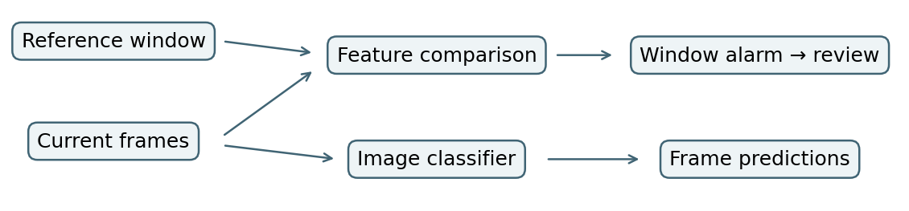

## Abstract

An industrial loading dock monitor compares current camera images with images accepted during commissioning. This report examines two questions relevant to its reliability gate. Does learning the similarity measure improve sensitivity at a nominal 5% per-window false-positive rate? Does a detected shift coincide with a loss of recognition accuracy? A controlled experiment on handwritten-digit images compared four detectors under blur and brightness changes. Across 300 mild-blur windows, a learned kernel rejected 22 times and a fixed Gaussian kernel rejected 10 times. All 12 additional rejections came from one split. Both kernels detected brightness changes in every window, although mean accuracy declined by less than one percentage point. The results characterize a controlled image experiment. A separate implementation specifies the public DINOv2/CIFAR-10-C replication of the industrial method.

## 1. Operating setting and research questions

Loss of focus, lens contamination and changes in illumination can alter the images arriving at a loading dock classifier. The classifier continues to produce predictions while a separate statistical monitor compares batches of incoming frames with a reference population. A rejection flags the window for operator review. The resulting decision concerns a population of frames. It does not certify the safety of an individual prediction.

The study evaluates detection probability, clean-window false alarms, and the change in classification accuracy for the same target identities. Three comparisons are of interest. First, can distributional tests detect changes that a feature centroid or a classifier's average entropy misses? Second, does training a kernel on historical blur increase power on fresh images? Third, do corruption conditions that trigger frequent alarms also cause the greatest loss of accuracy?

## 2. Research positioning

Gretton et al. [1] established maximum mean discrepancy (MMD) as a kernel two-sample statistic. Rabanser et al. [2] investigated dataset shift detection after dimensionality reduction. The present application follows this separation of representation and test. DINOv2 [3] supplies a frozen representation for the industrial method and its public replication. CIFAR-10-C [4] supplies controlled perturbations of identifiable clean images, allowing accuracy to be compared before and after corruption.

Liu et al. [5] learned deep kernels by optimizing a criterion related to two-sample test power. We adopt their distinction between selecting a kernel on development observations and testing with the frozen kernel on independent observations. Our estimator uses a single learned projection and a small grid of kernel weights. This restriction makes it possible to inspect which direction receives extra weight and when the procedure recovers the fixed kernel. The contribution is a comparative evaluation in a monitoring setting. Dong et al. [6] address the complementary problem of adapting a multimodal classifier at test time. Here an alarm triggers review and the encoder remains fixed.

## 3. Statistical methods

For clean reference images and recent target images, let $u_i$ and $v_j$ denote unit-normalized representations. Each window contains $n$ images per group. The hypothesis is $H_0:P_Z^R=P_Z^T$ against unequal feature distributions. For a kernel matrix $K$ on the pooled vectors and group weights $w_i=+1/n$ or $-1/n$, the biased empirical squared discrepancy is $D=w^\top K w$. The fixed kernel is $k_0(u,v)=\exp[-\|u-v\|^2/(2\sigma^2)]$, with bandwidth equal to the median pairwise distance among clean fitting examples.

**Learning the kernel.** Independent development groups provide clean and blurred images. Their mean difference, normalized to unit length, defines a direction $d$. Let $s$ denote the pooled development standard deviation along $d$. We use

$$k_a(u,v)=k_0(u,v)\left[0.05+0.95\exp\left(-a[d^\top(u-v)]^2/(2s^2)\right)\right].$$

The parameter $a$ belongs to $\{0,0.125,0.5,2,8\}$. At zero, the procedure recovers the fixed kernel. For equal development groups of size $m$, define $h_{ij}=k(u_i,u_j)+k(v_i,v_j)-k(u_i,v_j)-k(v_i,u_j)$ for distinct indices, and $r_i=(m-1)^{-1}\sum_{j\ne i}h_{ij}$. The selected weight maximizes $\bar r/\sqrt{4\operatorname{Var}(r_i)+10^{-8}}$. Standardization rewards a discrepancy that is large relative to its sampling variation. Both the direction and the weight are frozen before evaluation.

**Calibration and comparators.** Each trial uses identical images and 199 balanced permutations for all four tests. The centroid statistic is the distance between group means. The entropy statistic is the absolute difference in mean predictive entropy from a clean-trained multinomial logistic probe. Each test rejects when $(1+\#\{D_b\ge D_{obs}\})/200\le0.05$. Permutation validity requires exchangeability under the null. The empirical false-positive rate is the fraction of clean windows rejected. Paired accuracy loss is clean accuracy minus corrupted accuracy on the same target identities, expressed in percentage points.

## 4. Controlled image experiment

The completed experiment used the 1,797 labeled, 8-by-8 handwritten images in scikit-learn's digits dataset. Pixel intensities were divided by 16. Gaussian smoothing with standard deviations of 0.35, 0.65 and 1.0 pixels generated three blur conditions. The brightness condition added 0.15 before clipping at one. Each image was flattened and normalized after corruption. This choice isolates the behavior of the tests without introducing uncertainty about a pretrained encoder.

For each of three seeds (42, 43 and 44), identities were randomly partitioned into five disjoint pools for probe fitting, clean kernel development, blurred kernel development, reference sampling and target sampling. Kernel development used blur 0.65. Within a seed, 100 windows of 32 reference and 32 target images were sampled. Clean and corrupted variants shared target identities across conditions. Different trials could reuse images. Reported accuracy averages target-window accuracy with equal trial weight.

## 5. Results

**Table 1.** Alarm counts out of 300 windows per condition. Accuracy is the percentage of correctly classified target images, averaged over the same windows.

| Condition | Fixed MMD | Learned MMD | Centroid | Entropy | Accuracy |
|:--|--:|--:|--:|--:|--:|
| Clean | 8 | 11 | 7 | 17 | 93.76% |
| Mild blur (0.35) | 10 | 22 | 7 | 13 | 93.61% |
| Moderate blur (0.65) | 300 | 300 | 268 | 292 | 90.71% |
| Strong blur (1.0) | 300 | 300 | 300 | 300 | 79.05% |
| Brightness | 300 | 300 | 300 | 250 | 93.05% |

The learned and fixed tests flagged 3.7% and 2.7% of clean windows, respectively. Their mild-blur detection rates were 7.3% and 3.3%. The two methods operated at the same nominal threshold but had different observed false-alarm rates. The mild-blur difference cannot be interpreted as a four-point gain at exactly matched empirical specificity.

Seeds 42 and 43 selected weight zero and the detectors agreed. Seed 44 selected weight two and raised 17 mild-blur alarms compared with five for fixed MMD. Moderate blur yielded identical MMD results across all trials while the centroid missed 32 windows. These results provide evidence for the utility of distributional comparison under this corruption, but limited evidence that kernel learning adds a reproducible benefit.

Brightness and strong blur yielded identical MMD alarm counts. Their accuracy losses were 0.71 and 14.71 percentage points, respectively. An alarm established a detectable feature change in both cases. The paired classification outcome distinguished their operational consequences.

## 6. DINOv2 replication and external validity

The supplied CIFAR pipeline encodes the final 384-dimensional class token from DINOv2 ViT-S/14 with the checkpoint's image processor. A common random subset of 2,000 CIFAR-10 test identities supplies the five disjoint pools. The logistic probe sees only its designated clean fitting pool. This compact design reserves the other identities for kernel development and evaluation. Development uses motion blur at severity 3. Evaluation covers clean images and five severities each of motion blur, Gaussian noise and brightness, at window sizes 32, 64 and 128. Matched corruptions are indexed by the original test identity; clean archive labels are checked against the source ordering. The included entry point generates trial statistics for this replication. DINOv2/CIFAR and industrial performance estimates were unavailable for this report.

A blur-trained projection could transfer poorly to novel shifts. Frozen features can also discard information relevant to focus or exposure. The three random splits reuse a single digit corpus, so trial counts describe conditional rejection frequencies. Treating 300 resampled windows as independent deployment episodes would understate uncertainty. For loading dock video, temporal dependence and repeated testing require evaluation over independent camera periods or justified block permutations. An industrial assessment should report alarms per operating hour, detection delay and independently verified error rates across cameras.

## References

1. Gretton et al. [A Kernel Two-Sample Test](https://www.jmlr.org/papers/v13/gretton12a.html). JMLR, 2012.
2. Rabanser, Günnemann and Lipton. Failing Loudly. NeurIPS, 2019.
3. Oquab et al. [DINOv2](https://arxiv.org/abs/2304.07193). 2023.
4. Hendrycks and Dietterich. Benchmarking Neural Network Robustness to Common Corruptions and Perturbations. ICLR, 2019. [Data release](https://zenodo.org/records/2535967).
5. Liu, Xu, Lu, Zhang, Gretton and Sutherland. [Learning Deep Kernels for Non-Parametric Two-Sample Tests](https://proceedings.mlr.press/v119/liu20m.html). ICML, 2020.
6. Dong, Chatzi and Fink. Towards Robust Multimodal Open-set Test-time Adaptation via Adaptive Entropy-aware Optimization. ICLR, 2025.
